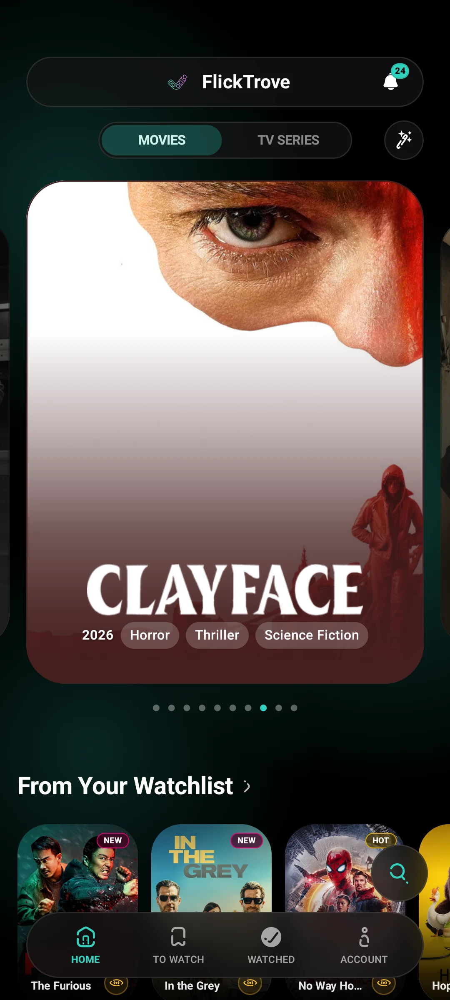
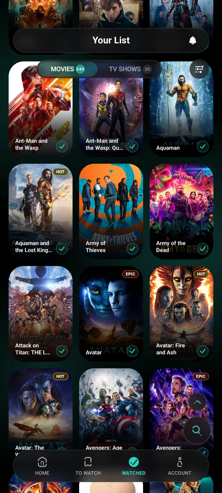
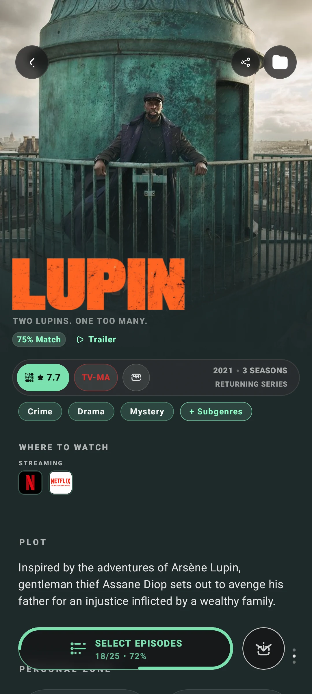
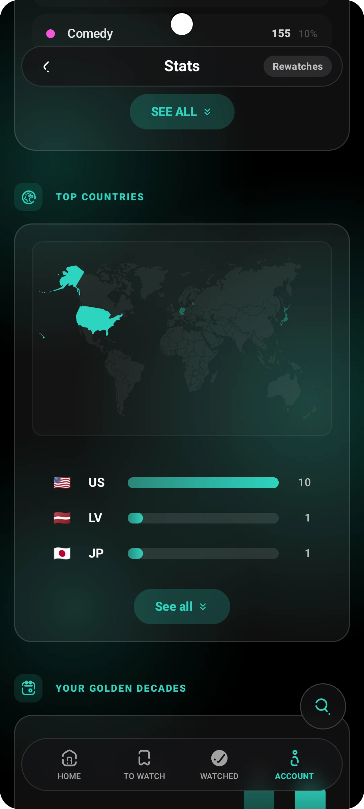
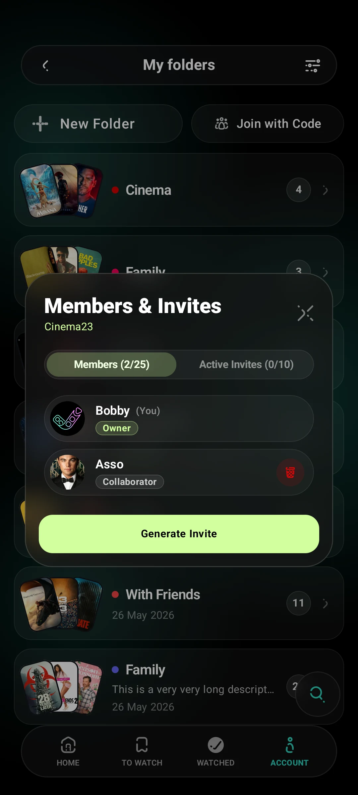
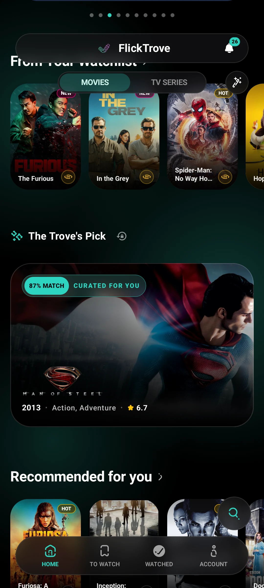
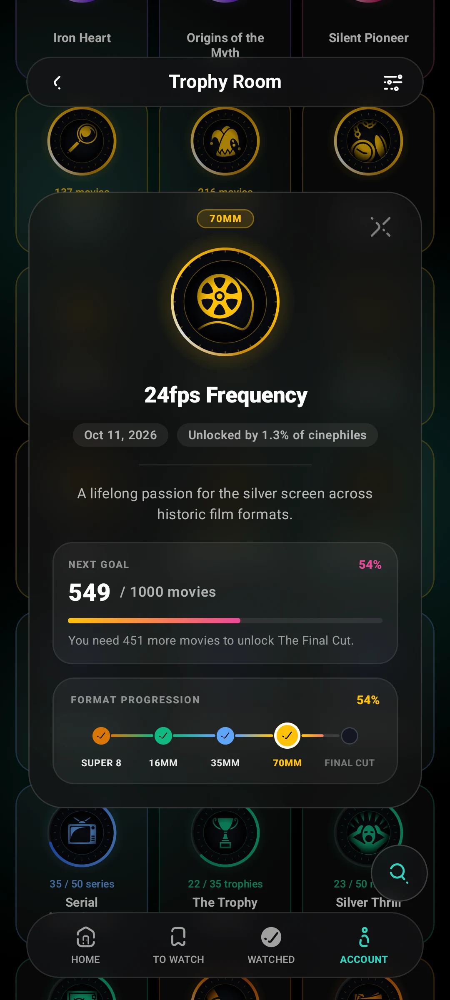
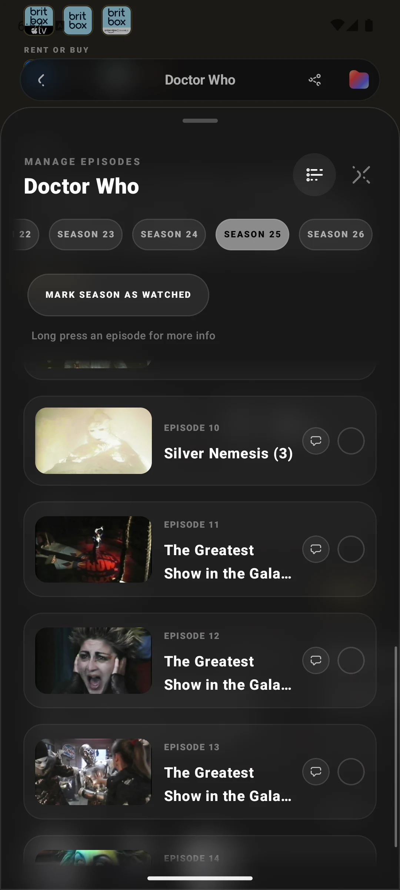
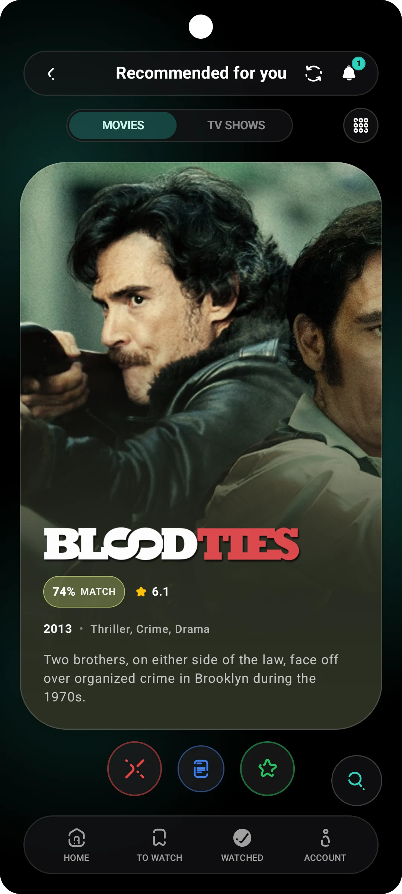
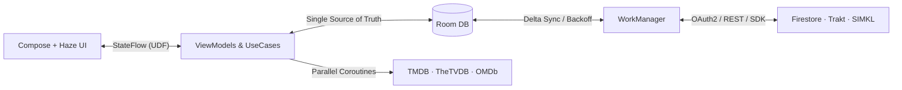

### *The personal cinema & TV show companion for Android.*

  
  
  
  

  <a href="#the-project">Overview</a> •
  <a href="#download--installation">Download</a> •
  <a href="#key-features">Features</a> •
  <a href="#ui-screenshots">Screenshots</a> •
  <a href="#architecture--technology">Architecture</a> •
  <a href="#future-roadmap">Roadmap</a>

*60/120 FPS glassmorphic interface, dynamic poster-driven theming, full **TMDB** catalog, **Trakt & SIMKL** sync, and 100% offline-first tracking built in **Kotlin** & **Jetpack Compose**.*

 

  
<b> Table of Contents</b>

  <ol>
    <li><a href="#the-project"> The Project</a></li>
    <li><a href="#download--installation"> Download & Installation</a></li>
    <li><a href="#key-features"> Key Features</a></li>
    <li><a href="#ui-screenshots"> UI Screenshots</a></li>
    <li><a href="#architecture--technology"> Architecture & Technology</a></li>
    <li><a href="#design--ui"> Design & UI</a></li>
    <li><a href="#developer-note"> Developer Note</a></li>
    <li><a href="#usage"> Usage</a></li>
    <li><a href="#future-roadmap"> Future Roadmap</a></li>
    <li><a href="#license"> License</a></li>
    <li><a href="#support-the-project"> Support the Project</a></li>
    <li><a href="#contacts--credits"> Contacts & Credits</a></li>
  </ol>

---

<h2 id="the-project"> The Project</h2>

**What is the motivation behind FlickTrove?**
There are many apps for tracking movies and TV shows, but they often lack visual polish or feel sluggish. The goal of FlickTrove is to provide enthusiasts with not just a useful tool, but a premium, responsive, and delightful experience, fully utilizing modern Android technologies.

This project solves the need for an elegant personal library, cloud-synchronized, with timely notifications for new releases.

---

<h2 id="download--installation"> Download & Installation</h2>

Experience FlickTrove on your Android device right now. Download the latest compiled APK directly from our releases page:

 

  
    
  
   
  Scan from your phone to jump straight to the latest APK release

 

> [!IMPORTANT]
> Since the app is not currently distributed via the Google Play Store, you will need to allow **"Install from unknown sources"** in your Android security settings before installing the downloaded APK file.

---

<h2 id="key-features"> Key Features</h2>

FlickTrove is not just a tracker — it's a personal cinema companion custom-built for movie and TV series lovers:

<table>
  <tr>
    <td width="50%" valign="top">
      <h3>🔮 The Trove's Pick & Taste Matrix</h3>
      An authentic daily ritual on your Home feed: hold the frosted energy lens to unseal your pick with gravitational bubbles, ring haptics, and a particle burst. Powered by <code>CalculateMatchScoreUseCase</code> with genre vectors, 64-bit micro-clustering, recency decay, and Bayesian quality smoothing.
    </td>
    <td width="50%" valign="top">
      <h3>🏛️ Trophy Room Gamification</h3>
      <strong>52 unique achievements</strong> across historical film stock formats (<em>Super 8</em>, <em>16mm</em>, <em>35mm</em>, <em>70mm</em>, <em>The Final Cut</em>) plus 12 secret <em>Lost Reels</em>. 100% offline-first async evaluation, real-time floating unlock banners, and global community rarity stats.
    </td>
  </tr>
  <tr>
    <td width="50%" valign="top">
      <h3>⏱️ Watch Diary & 52-Week Heatmap</h3>
      100% offline-first diary tracking every viewing, rewatch, and TV episode session. Includes a filmstrip timeline with sticky month headers, personal notes, emotional <em>"Vibes"</em>, half-star ratings, and a <strong>GitHub-style 52-Week Activity Heatmap</strong>.
    </td>
    <td width="50%" valign="top">
      <h3>💬 CommsUni & Episode Threads</h3>
      Write Markdown reviews up to 8,000 chars, tag spoilers, link <code>#Movie</code>/<code>#TV</code> inline poster chips, attach <strong>KLIPY</strong> GIFs, and interact with the federated <strong>CommsUni</strong> network — including isolated threads per TV episode.
    </td>
  </tr>
  <tr>
    <td width="50%" valign="top">
      <h3>☁️ Offline-First + Trakt & SIMKL Sync</h3>
      Full Room DB library with zero connectivity required. Seamlessly syncs in the background with <strong>Firebase Firestore</strong>, <strong>Trakt.tv</strong>, and <strong>SIMKL</strong> (OAuth 2.0 + PKCE) via WorkManager.
    </td>
    <td width="50%" valign="top">
      <h3>🤝 Collaborative Folders & Widgets</h3>
      Curate watchlists together in real time via <code>FT-XXXXX</code> invite codes (up to 25 members) with optimistic offline updates, plus interactive <strong>Glance</strong> home screen widgets for direct episode check-off.
    </td>
  </tr>
</table>

  <b>Migrate in seconds from:</b>&nbsp;
  <code>Letterboxd</code> · <code>IMDb</code> · <code>Trakt.tv</code> · <code>SIMKL</code> · <code>TVTime</code> · <code>Serializd</code> · <code>Cinemaniac</code> · <code>CSV / JSON / YAML</code>

  
<b> Explore all features (Discovery, TV Tracking, Import, 28+ Languages & more)</b>

   

  **Discovery & Curation**
  - 🎠 **Cinematic Discovery & Home Feed**: Auto-scrolling **Hero Spotlight Carousel** showcasing trending titles with official logo overlays.
  - 🎲 **Surprise Me**: Instant random pick or guided assistant by available time, mood, and viewing company (*Solo*, *Date Night*, *Friends*, *Family*).
  - 🥇 **Top 10 FlickTrove & 📈 Box Office Insights**: Daily community Top 10 alongside domestic/international box office weekends and all-time records.
  - 🎭 **Cinematic Sagas & Franchises**: Dedicated timelines for major franchises (MCU, Star Wars, Harry Potter, Middle-earth, etc.) with completion percentage and total saga runtime.
  - 📁 **Custom Folders**: Bespoke folders with a custom Color Wheel, rich descriptions, and flexible sorting.
  - 📰 **Film Magazine & Streaming Providers**: Curated editorial news, JustWatch streaming/rent/buy availability via TMDB, and HD in-app YouTube trailers.
  - 🔍 **Natural Language Search**: Instant TMDB search powered by a bilingual keyword dictionary for semantic mood and theme lookups.

  **Tracking, Diary & Sharing**
  - 🎬 **Episodic TV Tracking**: Check off episodes and seasons, track next air dates, monitor up-to-date status, and preserve watched episode history even when dropping or pausing shows.
  - 🎟️ **Advance Screenings & Festival Previews**: Long-press the action button on unreleased titles to log festival or press screenings (Cannes, Venice) prior to commercial release.
  - 📸 **Cinematic Story Card Sharing**: High-fidelity shareable cards in 9:16, 1:1, 4:5, and 16:9 with dynamic color extraction and vibe stickers.
  - 📊 **Advanced Statistics, Flow Persona & Wrapped**: Watch time breakdowns, genre distributions, release decade heatmaps, top actors/directors, and shareable Wrapped PNG cards.
  - 🌍 **Global Anonymous Ratings**: Idempotent anonymous ratings alongside TMDB, IMDb, Rotten Tomatoes, and Metacritic scores.
  - 📅 **Release Reminders**: Local calendar notifications and customizable alert schedules for premieres and new episodes.

  **Localization, Migration & Privacy**
  - 🌍 **28+ Languages, Full RTL & Regional Age Ratings**: Native localization across 29 locales (🇮🇹 🇬🇧 🇺🇸 🇩🇪 🇪🇸 🇫🇷 🇧🇷 🇵🇹 🇷🇺 🇮🇳 🇯🇵 🇰🇷 🇨🇳 🇹🇼 🇮🇩 🇹🇷 🇵🇱 🇳🇱 🇨🇿 🇺🇦 🇭🇺 🇷🇴 🇸🇪 🇬🇷 🇻🇳 🇹🇭 🇸🇦 🇩🇰 🇫🇮) with full RTL mirroring and regional certifications (MPAA, Eirin, KMRB, LSF, RTÜK, FSK, CNC, ICAA, ClassInd, CBFC, BBFC, Kijkwijzer, KAVI).
  - 🎨 **Seasonal Adaptive App Icons**: Themed launcher icons (Halloween, Christmas) with an in-app live preview carousel.
  - 🔄 **Universal Data Import**: Recognizes exports from **Letterboxd**, **IMDb**, **Trakt.tv**, **SIMKL**, **TVTime**, **Serializd**, **Cinemaniac**, and custom **CSV/JSON/YAML**.
  - 🛡️ **Privacy & Safe Environment**: Content reporting system, zero third-party telemetry, and full local backup export/import.

---

<h2 id="ui-screenshots"> UI Screenshots</h2>

  <table>
    <tr>
      <td align="center"><b>Home & Dynamic Glow</b></td>
      <td align="center"><b>Personal Collection</b></td>
      <td align="center"><b>Immersive Details</b></td>
    </tr>
    <tr>
      <td align="center">&nbsp;&nbsp;&nbsp;&nbsp;</td>
      <td align="center">&nbsp;&nbsp;&nbsp;&nbsp;</td>
      <td align="center">&nbsp;&nbsp;&nbsp;&nbsp;</td>
    </tr>
    <tr>
      <td align="center"> <b>Advanced Statistics</b></td>
      <td align="center"> <b>Custom Folders & Curation</b></td>
      <td align="center"> <b>The Trove's Pick</b></td>
    </tr>
    <tr>
      <td align="center">&nbsp;&nbsp;&nbsp;&nbsp;</td>
      <td align="center">&nbsp;&nbsp;&nbsp;&nbsp;</td>
      <td align="center">&nbsp;&nbsp;&nbsp;&nbsp;</td>
    </tr>
    <tr>
      <td align="center"> <b>Trophy Room Gamification</b></td>
      <td align="center"> <b>TV Series & Episodic Progress</b></td>
      <td align="center"> <b>Interactive Discovery Swiper</b></td>
    </tr>
    <tr>
      <td align="center">&nbsp;&nbsp;&nbsp;&nbsp;</td>
      <td align="center">&nbsp;&nbsp;&nbsp;&nbsp;</td>
      <td align="center">&nbsp;&nbsp;&nbsp;&nbsp;</td>
    </tr>
  </table>

---

<h2 id="architecture--technology"> Architecture & Technology</h2>

Behind a gorgeous interface lies a solid and scalable engine built with modern Android best practices.

| Category | Stack / Library |
| :--- | :--- |
| **Language** |  |
| **Architecture** |  |
| **UI Framework** |   |
| **Navigation** |  |
| **Blur & Glassmorphism** |  |
| **Networking** |   |
| **Local Database** |  |
| **Dependency Injection** |  |
| **Images & Colors** |   |
| **Background Sync** |  |
| **Backend & Auth** |    |

<b> Technical Deep Dive & Architecture Flow</b>

 

- **Reactive Data Layer**: Built on Kotlin Coroutines and StateFlows for snappy, unidirectional data flow (UDF) and lifecycle safety.
- **Dependency Injection**: Powered by Dagger Hilt for clean modular boundaries, testability, and decoupled repository patterns.
- **Compose-Native Routing**: Navigation is orchestrated by **Voyager** (tab + stack navigator) with transition animations and state preservation.
- **Parallel Aggregation**: The Home Feed relies on `GetHomeFeedUseCase` firing TMDB and user database calls in parallel via coroutines, ensuring sub-second rendering.
- **Taste Matrix Engine**: Multi-vector recommendation engine (`CalculateMatchScoreUseCase`) balancing genre affinity vectors, zero-allocation 64-bit micro-clustering, recency half-life decay, Bayesian TMDB quality smoothing, and bilingual keyword semantics.
- **Offline-First Room SSOT**: Local Room DB acts as the immutable Single Source of Truth for watch states, custom folders, and 52 achievements.
- **Resilient Cloud Sync**: Background synchronization with cloud backends (Firebase Firestore, Trakt.tv, and SIMKL) is powered by Android **WorkManager** with exponential backoff, rate-limit safety, and automatic OAuth2 token refreshing.
- **Glassmorphic Render Hierarchy**: Custom `Haze` state architecture ensuring zero recursive self-blur feedback loops and 60/120 FPS buttery rendering.

---

<h2 id="design--ui"> Design & UI</h2>

Design is the true crown jewel of FlickTrove.

- 🪟 **Full Glassmorphism**: Real-time blur engine under panels, drawers, and top bars at 60/120 FPS.
- 🌈 **Dynamic Theming**: Predominant colors of movie posters and backdrops are dynamically extracted via Coil and AndroidX Palette to theme gradients, buttons, and accents.
- ✨ **Premium Animations**: Micro-interactions, custom haptic feedback, and bounce-click effects make the app feel responsive and alive.
- 🎭 **Seasonal Customization**: Adaptive launcher icons with interactive carousel previews celebrating events like Halloween and Christmas.

---

<h2 id="developer-note"> Developer Note</h2>

> [!NOTE]
> For security reasons, backend configuration files (such as Firebase's `google-services.json`) and private API keys (TMDB, TheTVDB, OMDb, Trakt, KLIPY) have been excluded from this repository.
>
> Therefore, the project cannot be cloned and compiled "out-of-the-box" and is not intended to be a plug-and-play application.

---

<h2 id="usage"> Usage</h2>

Once the app is launched:

1. Log in with Google, email/password, or jump straight in as a **Guest** (with full offline-first functionality).
2. Use the search bar or natural language keywords to find movies, TV series, actors, and directors.
3. Mark titles as "To Watch" (Watchlist), "Watched", or organize them into bespoke custom folders.
4. Log multiple viewings, customize watch dates, assign emotional *"Vibes"*, and record private diary notes.
5. Relive your cinematic journey in the **Diary** (Timeline & Calendar views), explore your viewing stats in the **Stats** tab, use **Surprise Me** when indecisive, and showcase your unlocked achievements in the **Trophy Room**.

---

<h2 id="future-roadmap"> Future Roadmap</h2>

FlickTrove is constantly evolving. In the future, the app will expand beyond a personal tracker into an even richer cinephile ecosystem:

- [ ] **Match with friends (Cine-Match):** See movies you and your friends have watched, and get recommendations based on your combined tastes (powered by the pre-computed 360° `TasteVector` matrix).
- [ ] **Media Server Live Scrobbling (Jellyfin, Plex, Emby):** Real-time automated scrobbling and episode tracking from self-hosted home media servers via serverless cloud webhooks at zero cost.
- [ ] **Public Shareable Folders:** Make any folder public and shareable via link — let anyone browse your curated collections on the web.
- [ ] **Web & PWA Client:** Access your FlickTrove library, watchlist, ratings, and custom collections from any desktop browser.
- [ ] **Cinema Diary & Venue Tagging:** Track whether you saw a title in Theaters, on Streaming, or on Physical Media (4K UHD / Blu-Ray).
- [ ] **Yearly Cinephile Challenge:** Set annual watch goals with dynamic progress tracking and pacing indicators.
- [ ] **Social Integration:** Follow your cinephile friends and browse their personal libraries, ratings, and trophy rooms.
- [ ] **Follow Actors & Directors:** Real-time alert feed the moment a followed director or actor announces a new project.
- [ ] **Calendar Integration:** Sync upcoming premiere dates and TV air dates directly to your Google Calendar.
- [ ] **AI-Powered Cinephile Concierge:** Conversational discovery assistant for contextual mood queries and deep film analysis.

---

<h2 id="license"> License</h2>

Copyright © 2026 Alessandro Basile. All rights reserved.

The source code is publicly exposed strictly for reference and sharing purposes. Reproduction, copying, modification, or redistribution of the code, as well as its use for commercial or non-commercial purposes, is strictly prohibited without the explicit written permission of the author. Please consult the `TERMS_OF_SERVICE.md` file for further details.

---

<h2 id="support-the-project"> Support the Project</h2>

FlickTrove is, and will always be, completely free, source-available, and ad-free. If this app is helping you organize your cinema and TV library, consider supporting its development! Every little bit helps keep the project alive and expanding.

 

  
  &nbsp;&nbsp;
  
  &nbsp;&nbsp;
  

 

  
<b>📈 Star History</b>

   
  

    <a href="https://www.star-history.com/#Alle-0/FlickTrove&Date">
      <picture>
        <source media="(prefers-color-scheme: dark)" srcset="https://api.star-history.com/svg?repos=Alle-0/FlickTrove&type=Date&theme=dark" />
        <source media="(prefers-color-scheme: light)" srcset="https://api.star-history.com/svg?repos=Alle-0/FlickTrove&type=Date" />
        
      </picture>
    </a>
  

---

<h2 id="contacts--credits"> Contacts & Credits</h2>

**Developed by:**

- 👨‍💻 **Alessandro Basile** - <alessandrobasile909@gmail.com>
- 🔗 **Project Link:** [FlickTrove on GitHub](https://github.com/Alle-0/FlickTrove) or [FlickTrove site](https://alle-0.github.io/FlickTrove)

**Community:**

- 💬 **Reddit:** Join [r/FlickTrove](https://www.reddit.com/r/FlickTrove/) to report bugs, suggest new features, and talk about the app's future!

**Credits & Useful Resources:**

- 🎬 [The Movie Database (TMDB) API](https://www.themoviedb.org/documentation/api) - For movie and TV show data
- 📺 [TheTVDB API](https://thetvdb.com/api-information) - For TV show data and artwork
- 🍿 [OMDb API](https://www.omdbapi.com/) - For additional movie data and ratings
- 📝 [Trakt API](https://trakt.docs.apiary.io/) - For sync and scrobbling
- 📡 [SIMKL API](https://api.simkl.org/) - For bidirectional sync and tracking
- 🌐 [CommsUni (commsuni.tv)](https://commsuni.tv/) - For federated community discussion and social comments network
- 👾 [KLIPY API](https://klipy.com/) - For searching and sharing GIFs in social comments
- 🍅 [Rotten Tomatoes](https://www.rottentomatoes.com/) - For critic and audience scores
- Ⓜ️ [Metacritic](https://www.metacritic.com/) - For aggregated critic reviews
- 🏆 [Game-Icons.net](https://game-icons.net/) - For achievement badge and trophy icons (licensed under [CC BY 3.0](https://creativecommons.org/licenses/by/3.0/))

> *This product uses the TMDB API but is not endorsed or certified by TMDB.*

 

  <i>Developed with passion for movie and TV show lovers.</i>

