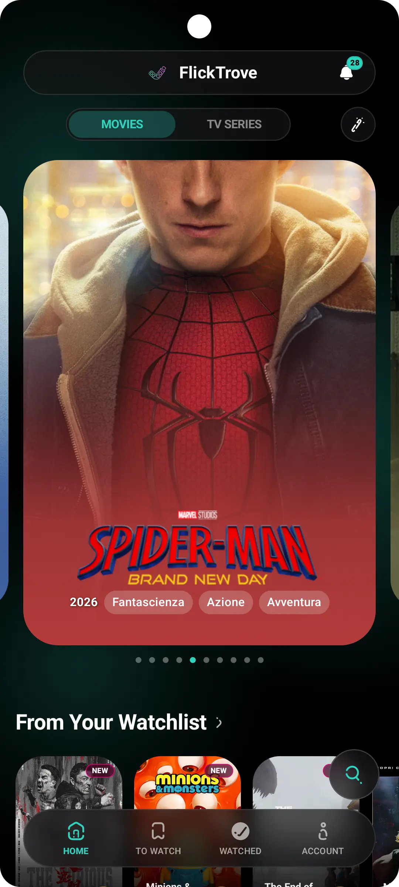
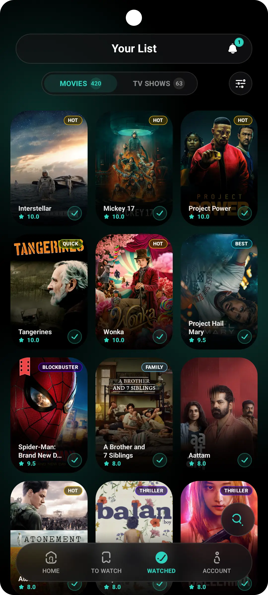
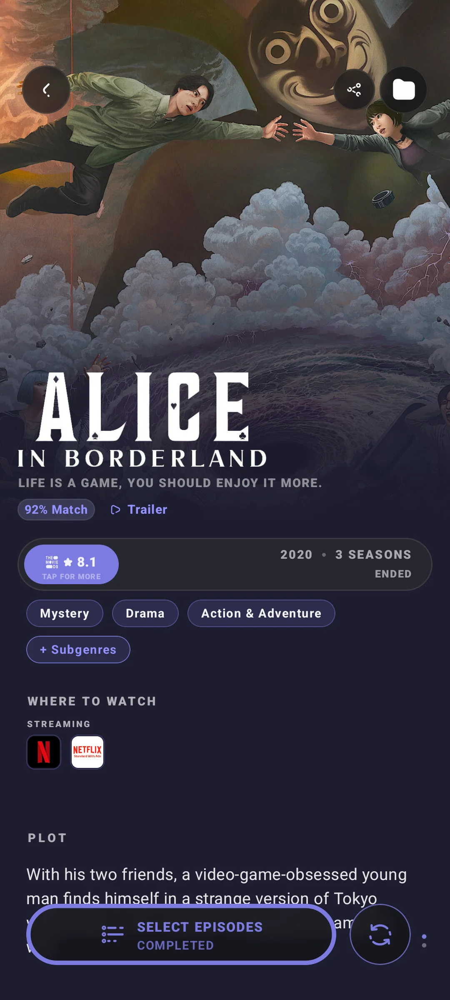
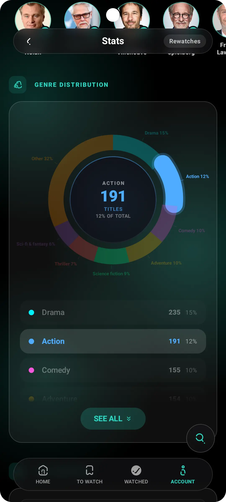
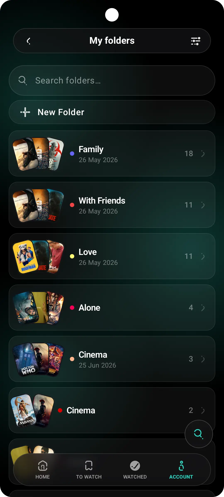
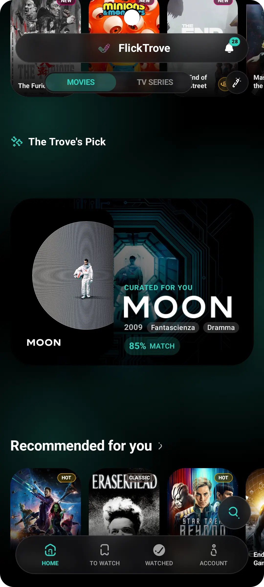
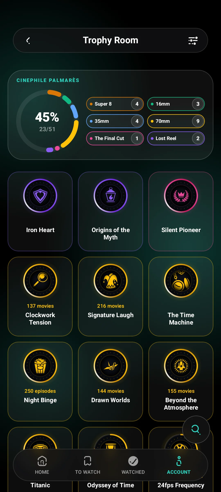
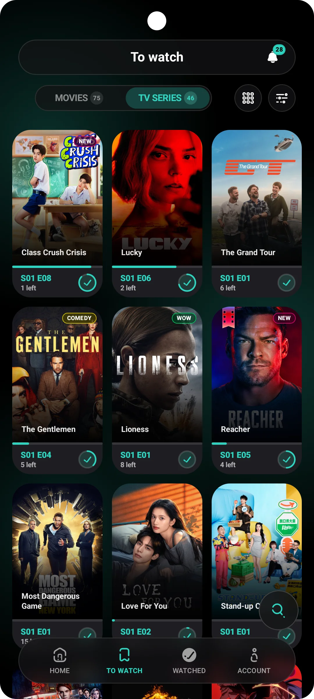
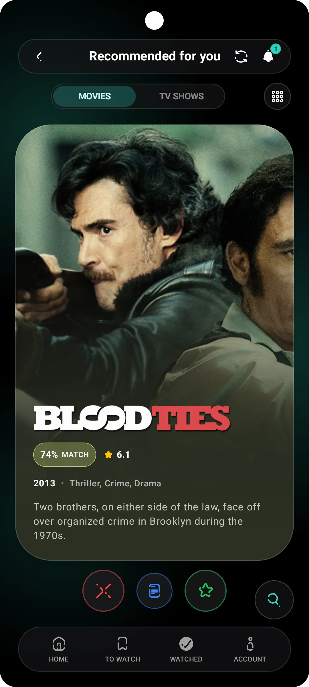

# FlickTrove — Premium Cinema & TV Show Tracker for Android

  
  
  
  
  
  
  
  

> **The ultimate personal cinema and TV show companion for Android.**
>
> *FlickTrove combines a unique glassmorphic interface, dynamic color palettes, and fluid animations with the full **TMDB catalog**, smart release notifications, and offline-first tracking built in **Kotlin** & **Jetpack Compose**.*

---

  
<b> Table of Contents</b>

  <ol>
    <li><a href="#the-project"> The Project</a></li>
    <li><a href="#download--installation"> Download & Installation</a></li>
    <li><a href="#key-features"> Key Features</a></li>
    <li><a href="#ui-screenshots"> UI Screenshots</a></li>
    <li><a href="#architecture--technology"> Architecture & Technology</a></li>
    <li><a href="#design--ui"> Design & UI</a></li>
    <li><a href="#developer-note"> Developer Note</a></li>
    <li><a href="#usage"> Usage</a></li>
    <li><a href="#future-roadmap"> Future Roadmap</a></li>
    <li><a href="#license"> License</a></li>
    <li><a href="#support-the-project"> Support the Project</a></li>
    <li><a href="#contacts--credits"> Contacts & Credits</a></li>
  </ol>

---

## <h2 id="the-project"> The Project</h2>

**What is the motivation behind FlickTrove?**
There are many apps for tracking movies and TV shows, but they often lack visual polish or feel sluggish. The goal of FlickTrove is to provide enthusiasts with not just a useful tool, but a premium, responsive, and delightful experience, fully utilizing modern Android technologies.

This project solves the need for an elegant personal library, cloud-synchronized, with timely notifications for new releases.

---

## <h2 id="download--installation"> Download & Installation</h2>

Experience FlickTrove on your Android device right now. Download the latest compiled APK directly from our releases page:

 

  

 

> **Note:** Since the app is not currently distributed via the Google Play Store, you will need to allow **"Install from unknown sources"** in your Android security settings before installing the downloaded APK file.

---

## <h2 id="key-features"> Key Features</h2>

FlickTrove is not just a tracker, it's a personal cinema companion and media library custom-built for movie and TV series lovers:

- 🎠 **Cinematic Discovery & Home Feed**: An immersive, auto-scrolling **Hero Spotlight Carousel** sits at the top, showcasing trending titles with official logo overlays.
- 🧠 **The Trove's Pick & Taste Matrix**: Our proprietary multi-vector recommendation engine evaluates your personal taste profile across genre affinities, 64-bit micro-clustering, recency half-life decay, Bayesian quality smoothing, and bilingual keyword dictionaries (`CalculateMatchScoreUseCase`) to highlight tailored recommendations with custom Match Scores.
- 🎲 **Surprise Me**: A smart recommendation assistant to overcome decision fatigue. Choose an instant random pick or follow the guided path selecting your available time, emotional mood, and viewing company (*Solo*, *Date Night*, *Friends*, *Family*) to find the ideal title to watch.
- 🥇 **Top 10 FlickTrove**: Custom ranking algorithm surfacing the 10 most popular titles among users, refreshed every 30 days.
- 📈 **Box Office Insights**: Real-time domestic and international box office rankings, Weekend Top 10 grosses, and all-time box office records.
- 🏛️ **Trophy Room & Cinephile Gamification**: 51 unique achievements and progressive milestones across historical film stock formats (*Super 8*, *16mm*, *35mm*, *70mm*, *The Final Cut*) and 12 secret *Lost Reels*. Features 100% offline-first async evaluation, real-time floating unlock banners (`TrophyUnlockBanner`), global community rarity stats (24h TTL cache), and server-validated Patron tier.
- ⏱️ **Cinephile Watch Diary (Timeline & Calendar Views)**: Dedicated 100% offline-first global diary tracking every viewing, rewatch, and TV episode session with zero network calls. Features dual view modes: a fluid chronological filmstrip timeline with monthly sticky headers and personal note callouts (`personalNote`), plus an interactive 7-column monthly calendar grid displaying poster thumbnails inside day cells, day detail sheets, and Anti-Tenet chronological rewatch calculation.
- 💖 **Vibes & Mood Journaling**: Tag titles with emotional *"Vibe"* stickers, personal star ratings (1-10 with half-star precision), and private review diaries via the interactive Peek-a-Boo Check-In Drawer.
- 🎭 **Cinematic Sagas & Franchises**: Dedicated timelines for major movie franchises (Marvel MCU, Star Wars, Harry Potter, Middle-earth, etc.) tracking your completion percentage, progress pill, and total saga runtime.
- 📁 **Custom Folders & Curated Collections**: Create bespoke folders with custom hex colors via an interactive Color Wheel, rich descriptions, and flexible sorting. Organize themed marathons, personal rankings, or watchlists your way.
- 🤝 **Collaborative Shared Folders**: Invite friends and family to curate watchlists together in real-time. Share folders via temporary alphanumeric invite codes (`FT-XXXXX`) or direct links, collaborate with up to 25 simultaneous members, manage permissions with Owner and Collaborator roles, and enjoy instantaneous optimistic updates with full offline support.
- 🎨 **Seasonal Adaptive App Icons**: Personalize your home screen with themed launcher icons (including Halloween, Christmas, Classic Gold, and Neo Mint) with an interactive in-app live preview carousel.
- 🔍 **Natural Language Search & TMDB Catalog**: Instant search across the entire TMDB catalog for movies, TV shows, and people. Powered by a comprehensive bilingual keyword dictionary for semantic mood and theme lookups.
- 🎬 **Episodic TV Tracking**: Full TV series lifecycle management. Spunta episodes and seasons, track next upcoming air dates, monitor *"In pari"* (up-to-date) completion status, and preserve your watched episode history even when dropping or pausing shows.
- ☁️ **Cloud & Live Sync**: Native Firebase Firestore backup alongside seamless, two-way background synchronization with **Trakt.tv** and **SIMKL** (OAuth 2.0 with PKCE) for watch history, personal ratings, watchlist, and custom folders via Android WorkManager.
- 📴 **Offline-First Architecture**: Access your entire library, update watch states, rate titles, and take personal notes without an internet connection, backed by a solid local Room database.
- 🌍 **15 Languages & Regional Age Ratings**: Full app-wide native localization supporting 15 languages and regional locales (🇮🇹 🇬🇧 🇺🇸 🇩🇪 🇪🇸 🇫🇷 🇧🇷 🇷🇺 🇮🇳 🇯🇵 🇰🇷 🇨🇳 🇹🇼 🇮🇩 🇹🇷) with localized regional film certifications (MPAA, Eirin, KMRB, LSF, RTÜK, FSK, CNC, ICAA, ClassInd, CBFC, BBFC).
- 🍿 **Streaming Providers & Trailers**: Discover where to stream, buy, or rent any title in your country, powered by JustWatch data via TMDB, alongside high-definition in-app YouTube trailers.
- 📅 **Release Reminders & Notifications**: Never miss theatrical premieres or streaming releases with local calendar notifications and customizable alert schedules.
- 📰 **Film Magazine & Editorial Collections**: Dedicated news section featuring articles from top film publications alongside curated editorial spotlight collections.
- 📊 **Advanced Statistics & Cinephile Wrapped**: Comprehensive watch time breakdowns (days, hours, minutes), genre distributions, release decade heatmaps, favorite actor/director frequency, and shareable Wrapped cards.
- 🌍 **Global Anonymous Ratings**: Your personal ratings contribute anonymously and idempotently to the global FlickTrove rating, visible alongside TMDB, IMDb, Rotten Tomatoes, and Metacritic scores.
- 💬 **Community & Federated Social Network**: Write reviews, rate titles, attach native images and Giphy GIFs, format with Markdown, tag spoilers, and interact with the federated **CommsUni (commsuni.tv)** network.
- 📱 **Interactive Glance Widgets**: Glanceable Android home screen widgets for viewing your movie watchlist, now watching, and TV series in progress with direct episode check-off from your launcher.
- 🔄 **Universal Data Import**: Effortless migration engine recognizing backup exports from **Letterboxd**, **IMDb**, **Trakt.tv**, **SIMKL**, **TVTime**, **Serializd**, **Cinemaniac**, and custom **CSV/JSON/YAML** files.
- 🛡️ **Privacy & Safe Environment**: Built-in reporting system to flag inappropriate content, zero third-party telemetry, and full local backup export/import capabilities.

---

## <h2 id="ui-screenshots"> UI Screenshots</h2>

  <table>
    <tr>
      <td align="center"><b>Home & Dynamic Glow</b></td>
      <td align="center"><b>Personal Collection</b></td>
      <td align="center"><b>Immersive Details</b></td>
    </tr>
    <tr>
      <td align="center">&nbsp;&nbsp;&nbsp;&nbsp;</td>
      <td align="center">&nbsp;&nbsp;&nbsp;&nbsp;</td>
      <td align="center">&nbsp;&nbsp;&nbsp;&nbsp;</td>
    </tr>
    <tr>
      <td align="center"> <b>Advanced Statistics</b></td>
      <td align="center"> <b>Custom Folders & Curation</b></td>
      <td align="center"> <b>The Trove's Pick</b></td>
    </tr>
    <tr>
      <td align="center">&nbsp;&nbsp;&nbsp;&nbsp;</td>
      <td align="center">&nbsp;&nbsp;&nbsp;&nbsp;</td>
      <td align="center">&nbsp;&nbsp;&nbsp;&nbsp;</td>
    </tr>
    <tr>
      <td align="center"> <b>Trophy Room Gamification</b></td>
      <td align="center"> <b>TV Series & Episodic Progress</b></td>
      <td align="center"> <b>Interactive Discovery Swiper</b></td>
    </tr>
    <tr>
      <td align="center">&nbsp;&nbsp;&nbsp;&nbsp;</td>
      <td align="center">&nbsp;&nbsp;&nbsp;&nbsp;</td>
      <td align="center">&nbsp;&nbsp;&nbsp;&nbsp;</td>
    </tr>
  </table>

---

## <h2 id="architecture--technology"> Architecture & Technology</h2>

Behind a gorgeous interface lies a solid and scalable engine. We used the best practices of modern Android development.

| Category | Stack / Library |
| :--- | :--- |
| **Language** |  |
| **Architecture** |  |
| **UI Framework** |   |
| **Navigation** |  |
| **Blur & Glassmorphism** |  |
| **Networking** |   |
| **Local Database** |  |
| **Dependency Injection** |  |
| **Images & Colors** |   |
| **Background Sync** |  |
| **Backend & Auth** |    |

<b> Technical Deep Dive</b>

 

FlickTrove adopts the most modern Android patterns:

- **Reactive Data Layer**: Built on Kotlin Coroutines and StateFlows for snappy, unidirectional data flow (UDF) and lifecycle safety.
- **Dependency Injection**: Powered by Dagger Hilt for clean modular boundaries, testability, and decoupled repository patterns.
- **Compose-Native Routing**: Navigation is orchestrated by **Voyager** (tab + stack navigator) with transition animations and state preservation.
- **Parallel Aggregation**: The Home Feed relies on `GetHomeFeedUseCase` firing TMDB and user database calls in parallel via coroutines, ensuring sub-second rendering.
- **Taste Matrix Engine**: Multi-vector recommendation engine (`CalculateMatchScoreUseCase`) balancing genre affinity vectors, zero-allocation 64-bit micro-clustering, recency half-life decay, Bayesian TMDB quality smoothing, and bilingual keyword semantics.
- **Offline-First Room SSOT**: Local Room DB acts as the immutable Single Source of Truth for watch states, custom folders, and 51 achievements.
- **Resilient Cloud Sync**: Background synchronization with cloud backends (Firebase Firestore, Trakt.tv, and SIMKL) is powered by Android **WorkManager** with exponential backoff, rate-limit safety, and automatic OAuth2 token refreshing.
- **Glassmorphic Render Hierarchy**: Custom `Haze` state architecture ensuring zero recursive self-blur feedback loops and 60/120 FPS buttery rendering.

---

## <h2 id="design--ui"> Design & UI</h2>

Design is the true crown jewel of FlickTrove.

- 🪟 **Full Glassmorphism**: We use a custom blur engine to blur the content under panels, drawers, and top bars in real time at 60/120fps.
- 🌈 **Dynamic Theming**: The predominant colors of movie posters and backgrounds are dynamically extracted by Coil and AndroidX Palette to theme the entire screen (gradients, buttons, and accents).
- ✨ **Premium Animations**: Micro-interactions, custom haptic feedback, and bounce-click effects make the app incredibly responsive and "alive" under your fingers.
- 🎭 **Seasonal Customization**: Adaptive launcher icons with interactive carousel previews celebrating events like Halloween and Christmas.

---

## <h2 id="developer-note"> Developer Note</h2>

For security reasons, backend configuration files (such as Firebase's google-services.json) and private API keys (TMDB, TheTVDB, OMDB, Trakt, Giphy) have been excluded from this repository.

Therefore, the project cannot be cloned and compiled "out-of-the-box" and is not intended to be a plug-and-play application.

---

## <h2 id="usage"> Usage</h2>

Once the app is launched:

1. Log in with Google, email/password, or jump straight in as a **Guest** (with full offline-first functionality).
2. Use the search bar or natural language keywords to find movies, TV series, actors, and directors.
3. Mark titles as "To Watch" (Watchlist), "Watched", or organize them into bespoke custom folders.
4. Log multiple viewings, customize watch dates, assign emotional *"Vibes"*, and record private diary notes.
5. Relive your cinematic journey in the **Diary** (Timeline & Calendar views), explore your viewing stats in the **Stats** tab, use **Surprise Me** when indecisive, and showcase your unlocked achievements in the **Trophy Room**.

---

## <h2 id="future-roadmap"> Future Roadmap</h2>

FlickTrove is constantly evolving. In the future, the app will expand beyond a personal tracker into an even richer cinephile ecosystem:

- [ ] **Media Server Live Scrobbling (Jellyfin, Plex, Emby):** Real-time automated scrobbling and episode tracking from self-hosted home media servers via serverless cloud webhooks at zero cost.
- [ ] **Shared & Collaborative Folders:** Create collaborative watchlists with your partner or friends on Supabase with custom invite expiration and member revocation.
- [ ] **Public Shareable Folders:** Make any folder public and shareable via link — let anyone browse your curated collections on the web.
- [ ] **Web & PWA Client:** Access your FlickTrove library, watchlist, ratings, and custom collections from any desktop browser.
- [ ] **Cinema Diary & Venue Tagging:** Track whether you saw a title in Theaters, on Streaming, or on Physical Media (4K UHD / Blu-Ray).
- [ ] **Yearly Cinephile Challenge:** Set annual watch goals with dynamic progress tracking and pacing indicators.
- [ ] **Social Integration:** Follow your cinephile friends and browse their personal libraries, ratings, and trophy rooms.
- [ ] **Follow Actors & Directors:** Real-time alert feed the moment a followed director or actor announces a new project.
- [ ] **Calendar Integration (iCal):** Sync upcoming premiere dates and TV air dates directly to your Google or Apple Calendar.
- [ ] **AI-Powered Cinephile Concierge:** Conversational discovery assistant for contextual mood queries and deep film analysis.

---

## <h2 id="license"> License</h2>

Copyright © 2026 Alessandro Basile. All rights reserved.

The source code is publicly exposed strictly for reference and sharing purposes. Reproduction, copying, modification, or redistribution of the code, as well as its use for commercial or non-commercial purposes, is strictly prohibited without the explicit written permission of the author. Please consult the TERMS_OF_SERVICE.md file for further details.

---

## <h2 id="support-the-project"> Support the Project</h2>

FlickTrove is, and will always be, completely free, source-available, and ad-free. If this app is helping you organize your cinema and TV library, consider supporting its development! Every little bit helps keep the project alive and expanding.

 

  
  &nbsp;&nbsp;&nbsp;&nbsp;
  
  
  
  

 

---

## <h2 id="contacts--credits"> Contacts & Credits</h2>

**Developed by:**

- 👨‍💻 **Alessandro Basile** - <alessandrobasile909@gmail.com>
- 🔗 **Project Link:** [FlickTrove on GitHub](https://github.com/Alle-0/FlickTrove) or [FlickTrove site](https://alle-0.github.io/FlickTrove)

**Community:**

- 💬 **Reddit:** Join [r/FlickTrove](https://www.reddit.com/r/FlickTrove/) to report bugs, suggest new features, and talk about the app's future!

**Credits & Useful Resources:**

- 🎬 [The Movie Database (TMDB) API](https://www.themoviedb.org/documentation/api) - For movie and TV show data
- 📺 [TheTVDB API](https://thetvdb.com/api-information) - For TV show data and artwork
- 🍿 [OMDb API](http://www.omdbapi.com/) - For additional movie data and ratings
- 📝 [Trakt API](https://trakt.docs.apiary.io/) - For sync and scrobbling
- 📡 [SIMKL API](https://api.simkl.org/) - For bidirectional sync and tracking
- 🌐 [CommsUni (commsuni.tv)](https://commsuni.tv/) - For federated community discussion and social comments network
- 👾 [Giphy API](https://developers.giphy.com/docs/api/) - For searching and sharing GIFs in social comments
- 🍅 [Rotten Tomatoes](https://www.rottentomatoes.com/) - For critic and audience scores
- Ⓜ️ [Metacritic](https://www.metacritic.com/) - For aggregated critic reviews
- 🏆 [Game-Icons.net](https://game-icons.net/) - For achievement badge and trophy icons (licensed under [CC BY 3.0](https://creativecommons.org/licenses/by/3.0/))

> *This product uses the TMDB API but is not endorsed or certified by TMDB.*

 

  <i>Developed with passion for movie and TV show lovers.</i>

